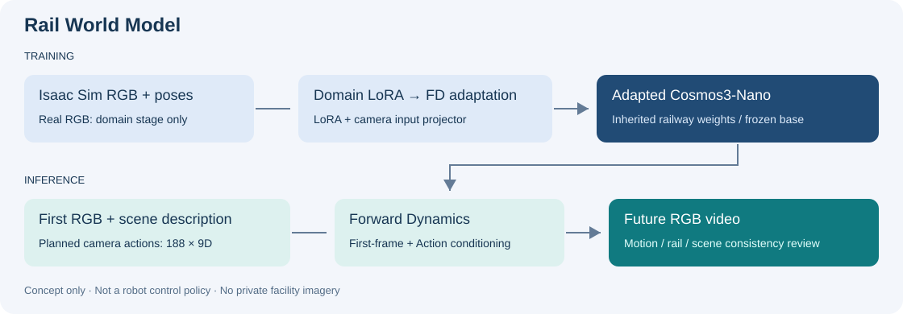

# Rail World Model

카메라 이동 경로를 입력받아 철도 주행 영상을 생성하는 연구 프로젝트.

NVIDIA Cosmos3-Nano에 철도 영상을 후속학습하고, 첫 이미지와 프레임별 카메라 이동·회전값으로 이후 영상을 생성한다.



## 학습 방법

Isaac Sim에서 영상과 카메라 좌표를 함께 취득했다. 인접 프레임의 좌표 차이를 상대 이동 3값·회전 6값의 **9D Action**으로 변환해 영상과 연결했다.

학습은 두 단계로 나눴다.

1. **철도 영상 적응:** 생성부 LoRA를 학습하고, 가상 영상만 사용한 A와 가상·실사를 혼합한 B를 비교.
2. **카메라 경로 조건 학습:** 가상 영상·Action으로 생성부 LoRA와 카메라 입력 projector 일부를 학습.

가상 데이터는 학습 240개·검증 54개, 실사 RGB는 학습 107개·검증 13개다. 실사에는 검증된 pose가 없어 첫 번째 단계에만 사용했다.

현재 모델은 **FD500**이다. 기존 철도 초기 모델 → domain300 → FD300을 거쳐 200 updates를 추가했다. 전체 가중치를 학습하는 Full SFT는 아니다.

[데이터·Action 변환·학습 계보](docs/METHOD.md) · [수행 내용](docs/CONTRIBUTIONS.md)

## 결과

아래는 이전 FD300 단계의 A/B 비교다. 입력 이미지·Action·장면 설명·seed와 sampling 설정을 맞췄다. 현재 FD500 결과와 구분한다.

| 감속 요청 | STOP 요청 |
|---|---|
| [](assets/results/ab_decel30.mp4) | [](assets/results/ab_stop.mp4) |

- **감속:** 후반에 장면 변화가 줄어드는 경향이 관찰됨.
- **STOP:** 정지 요청에도 두 모델 모두 전진하는 실패 발생.
- **장면 유지:** 레일·시설물의 형상 변화와 주변 객체 움직임 부족이 남음.

실제 km/h를 측정한 결과는 아니다. B의 일관된 우위와 새 노선 일반화도 확인하지 못했다.

[가속 A/B 영상](assets/results/ab_accel10.mp4) · [시뮬레이터 원본/생성 비교](assets/results/sim_gt_vs_b_decel30.mp4) · [조건별 분석·출처](docs/MEDIA_GALLERY.md) · [결과·한계](docs/RESULTS.md)

## 실행

### 모델 없이 코드 확인

Python 3.10 이상. 외부 Python 패키지 없이 Action 생성·형식 검사와 단위 테스트를 실행할 수 있다.

```bash
git clone https://github.com/tanskin1011/cosmos3-nano-rail-lora.git rail-world-model
cd rail-world-model

PYTHONPATH=src python3 -m unittest discover -s tests -v
PYTHONPATH=src python3 -m rail_world_model make-action \
  --profile const10 --output /tmp/rail_demo_const10.json
PYTHONPATH=src python3 -m rail_world_model validate-action \
  /tmp/rail_demo_const10.json --transitions 188
```

`make-action`은 직선 이동 계획을 JSON으로 만든다. 영상 생성 명령은 아래와 같다. 출력 파일이 이미 있으면 새 이름을 지정한다.

### 영상 생성

첫 이미지·장면 설명·188개 Action을 입력한다. 출력 규격은 832×480·189프레임·24 FPS다.

native Cosmos Framework 환경과 모델·Base 의존 가중치·VAE·tokenizer가 필요하다. 각 경로는 로컬 `internal/runtime.json`에 지정한다.

```bash
# 입력·설정 검사
python3 infer.py --image input.png --action action.json \
  --prompt-file scene.txt --output outputs/demo --check

# 영상 생성
python3 infer.py --image input.png --action action.json \
  --prompt-file scene.txt --output outputs/demo --run
```

기존 Spark에서는 FD300의 GPU 실행을 확인했다. FD500 배포 후보는 새 경로에 복원해 전체 1,097개 텐서의 해시 일치를 CPU에서 확인했다. 복원 묶음의 GPU 생성과 다른 장비 실행은 아직 확인하지 않았다.

[추론 설정·상태·로그](docs/INFERENCE.md) · [GPU 실행 기록](docs/CLI_VERIFICATION.md) · [CPU 검사](docs/CLEAN_CPU_REPRODUCTION.md)

## 가중치

FD500 추론용 delta 가중치와 복원 도구를 준비했다. 원본 Base DCP·VAE·tokenizer는 별도로 필요하며, 가중치는 아직 외부에 업로드하지 않았다.

[가중치 구성·복원 방법](docs/WEIGHTS.md)

## 저장소 구조

```text
src/rail_world_model/   Action 처리·추론 CLI·자원 감시
configs/               설정 예시·학습 규약
scripts/               설정 연결·가중치 복원·배포 검사
tests/                 CPU 단위 테스트
docs/                  학습 방법·실행 안내·결과
assets/                구조도·대표 비교영상
infer.py               영상 추론 진입점
```

장비별 데이터·가중치·실행 설정은 Git에서 제외한 `local/`, `internal/`에 보관한다. NVIDIA 프레임워크는 외부 의존성으로 사용한다.

[폴더별 설명](docs/PROJECT_LAYOUT.md) · [개발 안내](docs/DEVELOPMENT.md) · [외부 구성요소·자료 이용 범위](THIRD_PARTY.md)
