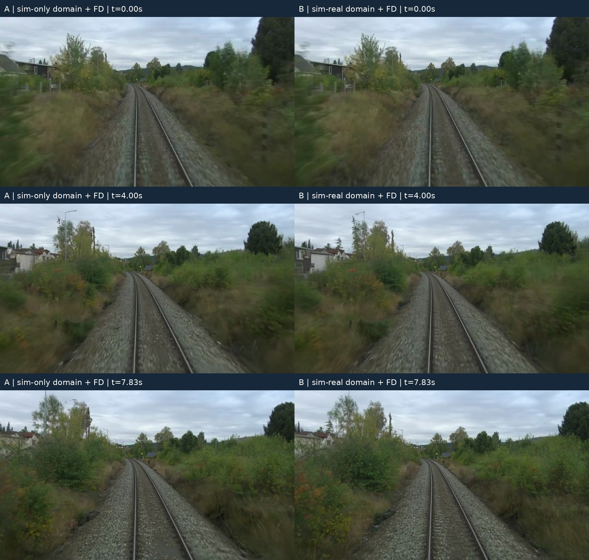
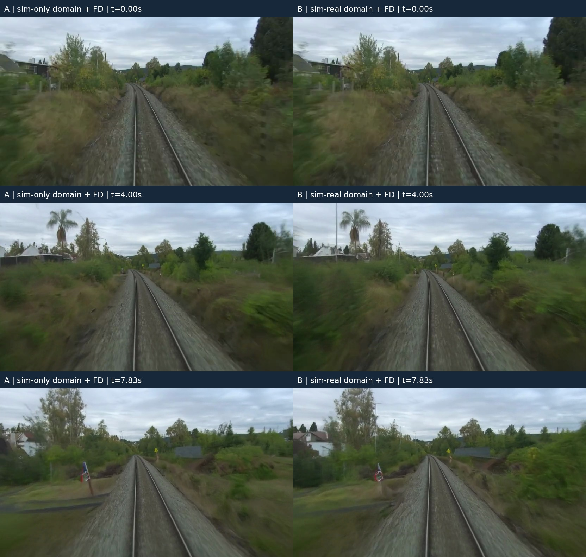

# Rail World Model

### 카메라 경로 조건을 이용한 철도 로봇 시점 영상 생성

**첫 이미지 + 장면 설명 + 계획된 카메라 경로 → 미래 RGB 영상**

NVIDIA Cosmos3-Nano를 철도 도메인에 적응시켜 로봇 학습·시험에 활용할 영상을 만드는 연구 프로젝트입니다. **로봇 모터를 직접 제어하는 정책 모델이나 안전성이 검증된 시뮬레이터는 아닙니다.**

[방법](docs/METHOD.md) · [수행 내용](docs/CONTRIBUTIONS.md) · [결과·한계](docs/RESULTS.md) · [추론 사용법](docs/INFERENCE.md)


> 위 도식은 구조 설명용입니다. 아래 대표 미디어는 사용자의 게시 요청 범위에서 기존 결과를 편집한 것입니다. 맵 원본·모델 가중치·내부 경로·미공개 측정값은 포함하지 않습니다.

## 문제와 접근

철도처럼 보이는 영상과 **원하는 주행 조건을 따르는 영상**은 다릅니다. 텍스트 조건 실험의 한계를 바탕으로 카메라 이동값을 직접 조건으로 사용하는 Forward Dynamics로 연구를 발전시켰습니다.

| 단계 | 수행 내용 | 설계 판단 |
|---|---|---|
| 데이터 | Isaac Sim RGB·카메라 pose 대응, 검수·분할 | 영상과 이동값의 시간축 일치 |
| 조건 표현 | 인접 pose → 상대 이동·회전 9D Action | STOP도 항등 회전이므로 전체 0 벡터가 아님 |
| Domain 적응 | 가상 전용 A / 가상·실사 혼합 B의 생성부 LoRA | 실사 RGB에 가짜 pose를 붙이지 않음 |
| FD 적응 | 가상 RGB·Action으로 LoRA + camera 입력 projector 학습 | 첫 이미지와 Action을 미래 영상의 조건으로 사용 |
| 비교·운영 | 입력·prompt·seed·설정 고정, CLI와 검증 도구 | 움직임 생성과 정확한 제어·장면 보존을 구별 |

최종 Nano B는 backbone 전체 Full SFT가 아닙니다. 공통 초기값도 이미 철도 학습을 거친 FD_joint300입니다. [방법·계보](docs/METHOD.md)

## 결과와 한계

| 확인한 항목 | 근거 수준 |
|---|---|
| 기존 가중치를 새 CLI로 사용 | 실제 GPU 실행 1회 통과, 1,097개 tensor hash 대조 |
| 영상 파일 생성 | 832×480 · 189프레임 · 24 FPS, 전체 디코딩 통과 |
| 조건 입력 | 첫 프레임 [0], camera domain2, 188개 Action 확인 |
| 연구 성능 | 기존 보고서에 제어·장면 실패도 기록. 모든 조건 성공으로 주장하지 않음 |
| 재현 | 비공개 자산 없는 CPU 검사와 기존 Spark GPU 실행을 구분. 다른 장비 GPU는 미검증 |

**남은 과제는 장면 구조·주변 객체 움직임의 유지와 정확한 속도 추종입니다.** 실사 혼합의 최종 A/B 우열이나 새 노선 일반화가 입증됐다고 서술하지 않습니다. [결과 해석](docs/RESULTS.md)

## 대표 비교영상

**A = 가상 전용 domain 적응 / B = 가상·실사 혼합 domain 적응. FD 단계는 같은 가상 데이터·카메라 조건을 사용합니다.** 이미지를 누르면 대응 MP4로 이동합니다.

| 감속 요청: 후반 변화 감소 경향 | STOP 실패: 정지 요청에도 전진 |
|---|---|
| [](assets/results/ab_decel30.mp4) | [](assets/results/ab_stop.mp4) |

- [감속 A/B 영상](assets/results/ab_decel30.mp4) · [가속 A/B 영상](assets/results/ab_accel10.mp4) · [STOP 실패 A/B 영상](assets/results/ab_stop.mp4)
- [Isaac Sim 원본 / 최종 B 생성 비교](assets/results/sim_gt_vs_b_decel30.mp4)
- [학습 이미지·대표 프레임·선택 이유와 한계](docs/MEDIA_GALLERY.md)

새 추론이 아닌 기존189프레임·24 FPS 결과입니다. 감속 경향을 정확한 km/h 재현으로 해석하지 않으며, B의 일관된 개선도 주장하지 않습니다. 실패 사례와 구조 변형을 함께 보여줍니다.

## 빠르게 실행해 보기 — GPU·비공개 데이터 불필요

Python 3.10 이상. 외부 Python 패키지가 필요 없습니다.

```bash
git clone https://github.com/tanskin1011/cosmos3-nano-rail-lora.git
cd cosmos3-nano-rail-lora
PYTHONPATH=src python3 -m unittest discover -s tests -v
PYTHONPATH=src python3 -m rail_world_model make-action \
  --profile const10 --output /tmp/rail_demo_const10.json
PYTHONPATH=src python3 -m rail_world_model validate-action \
  /tmp/rail_demo_const10.json --transitions 188
```

비공개 저장소이면 clone 권한이 필요합니다. 출력이 존재하면 다른 파일명을 사용하세요. 생성하는 Action은 **직선 카메라 이동의 수학적 예시**이며 실제 취득 pose나 모델의 속도 재현 성능을 입증하는 GT가 아닙니다.

실제 영상 생성은 원본 Nano 의존 가중치·최종 checkpoint·VAE·tokenizer·검증된 native 환경 및 로컬 runtime profile이 필요합니다.

```bash
python3 infer.py --image input.png --action action.json \
  --prompt-file scene.txt --output outputs/demo --check
python3 infer.py --image input.png --action action.json \
  --prompt-file scene.txt --output outputs/demo --run
```

[실행·상태·로그·중단](docs/INFERENCE.md) · [GPU 검증 범위](docs/CLI_VERIFICATION.md) · [비공개 자산 없는 CPU 재현](docs/CLEAN_CPU_REPRODUCTION.md)

## 개발 구조

```text
infer.py                    # 추론 CLI 진입점
src/rail_world_model/        # Action 검사·예시, 추론·자원 감시
configs/                    # 연구 설정·로컬 runtime 예시
tests/                      # 모델 없이 실행하는 테스트
docs/                       # 방법·결과·재현·공개 범위
assets/                     # 자체 구조도
```

NVIDIA 프레임워크 전체 복사본이 아닌 연구용 프로젝트 계층입니다. 과거 버전은 Git 이력과 `archive/legacy-before-rebuild-20261102`에 보존했습니다. 11월 1일 입력 이미지 교체 추론은 이번 포트폴리오 범위에서 제외했습니다.

[외부 구성요소·권리](THIRD_PARTY.md) · [공개 검토](docs/RELEASE_CHECKLIST.md) · [개발 상태](docs/DEVELOPMENT.md)
