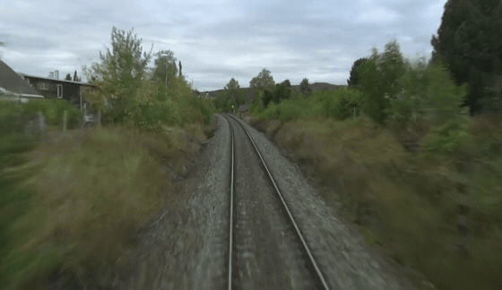

# Rail World Model

**첫 이미지와 카메라 경로로 생성하는 철도 주행 영상**

NVIDIA Cosmos3-Nano를 철도 영상에 후속학습한 프로젝트다. 텍스트만으로 주행 조건을 지정하는 방식에서 출발해, 프레임별 카메라 이동·회전값을 입력하는 Forward Dynamics로 확장했다.

[대표 영상](#대표-영상) · [학습 구조](#학습-구조) · [결과와-한계](#결과와-한계) · [실행](#실행) · [상세 문서](#상세-문서)

## 대표 영상

현재 **카메라 경로 조건부 모델 · 500step**에 감속 경로를 입력한 결과다. 미리보기를 누르면 전체 MP4를 열 수 있다.

| 실사 첫 이미지에서 생성 | 합성 철도 장면에서 생성 |
|---|---|
| [](assets/results/fd500_real_decel.mp4) | [](assets/results/fd500_sim_decel.mp4) |
| 높은 열차 시점과 곡선 선로를 유지하며, 후반에 배경 이동이 줄어드는 경향 | 낮은 철도 시점에서, 초반에 가까운 전주가 빠르게 지나가고 후반 이동이 감소 |

전체 영상은 **832×480 · 189프레임 · 24 FPS**다. GIF는 전체 길이를 8 FPS로 줄인 미리보기이며 프레임 보간이나 재생 속도 변경은 하지 않았다.

감속은 미리 지정한 카메라 경로다. 위험을 인지한 자동제동이나 실제 30→0 km/h 재현을 검증한 결과는 아니다. 합성 장면은 학습에 사용된 이미지이며 실사 장면에는 수목·건물 세부 변화가 남는다.

[실사 입력 MP4](assets/results/fd500_real_decel.mp4) · [합성 입력 MP4](assets/results/fd500_sim_decel.mp4) · [조건·출처·편집 기록](docs/MEDIA_GALLERY.md)

## 연구 목표

철도 로봇의 이동 조건을 바꿨을 때 그에 맞는 영상을 생성하는 것이 목표다. 전진하는 영상이 만들어지는지뿐 아니라, STOP·정속·가감속이 구분되는지와 레일·주변 구조가 유지되는지를 함께 살폈다.

| 기반 모델 | 학습 방식 | 현재 체크포인트 |
|---|---|---|
| NVIDIA Cosmos3-Nano | 생성부 LoRA + 카메라 입력 projector 일부 | 500step |

기존 철도 초기 모델 → 영상 적응300step → 카메라 경로 조건 학습300step → 추가200 updates의 계보다. 영상 생성부 LoRA와 카메라 입력부를 학습하고 나머지 기반 가중치는 고정했다. 원본 기록의 `FD500`은 현재500step 모델을 가리킨다.

## 학습 구조


**영상 적응** 단계에서는 생성부 LoRA를 학습했다. 가상 영상만 사용한 A와 가상·실사를 혼합한 B를 비교했다.

**카메라 경로 조건 학습** 단계에서는 가상 영상과 실제 렌더 카메라 좌표를 연결했다. 인접 프레임의 상대 이동3값·회전6값을 9D Action으로 만들고, 첫 이미지와 함께 입력해 이후 영상을 복원하도록 학습했다.

| 데이터 | Train | Validation | 사용 단계 |
|---|---:|---:|---|
| 가상 RGB·카메라 pose | 240 | 54 | domain·FD |
| 실사 RGB | 107 | 13 | domain |

실사에는 검증된 pose가 없어 domain 단계에만 사용했다. 모델 출력은 미래 RGB 영상이며 로봇 모터 제어 명령은 아니다.

[모델·코드 아키텍처](docs/ARCHITECTURE.md) · [학습 단계와 설정](docs/TRAINING.md) · [Action 변환 원리](docs/METHOD.md) · [프로젝트 수행 내용](docs/CONTRIBUTIONS.md)

## 결과와 한계

500step 모델의 감속 입력 사례5개에서는 후반 배경 이동이 줄어드는 경향이 기록됐다. 정지·정속·가감속 전체의 구분과 이전 모델 대비 개선은 추가 비교가 필요하다.

이전 **300step 모델**에서는 동일 조건 A/B 비교를 수행했다. 아래는 학습 데이터 구성에 따른 차이와 실패 사례를 확인하는 영상이다.

| 감속 A/B 비교 | STOP 실패 A/B 비교 |
|---|---|
| [](assets/results/ab_decel30.mp4) | [](assets/results/ab_stop.mp4) |

- 감속 요청에서 후반 장면 변화가 줄어드는 경향이 관찰됐다.
- STOP 요청에도 전진하는 실패가 남았다.
- 레일·시설물 형상 변화, 주변 객체 움직임 부족과 정확한 속도 추종이 해결 과제다.

B의 일관된 우위와 새 노선 일반화는 확인하지 못했다.

[가속 A/B 영상](assets/results/ab_accel10.mp4) · [시뮬레이터 원본/생성 비교](assets/results/sim_gt_vs_b_decel30.mp4) · [전체 결과·한계](docs/RESULTS.md)

## 실행

### 모델 없이 코드 확인

Python 3.10 이상에서 실행한다. Action 생성·형식 검사와 단위 테스트에는 외부 Python 패키지가 필요 없다.

```bash
git clone https://github.com/tanskin1011/rail-world-model.git
cd rail-world-model
PYTHONPATH=src python3 -m unittest discover -s tests -v
```

<details>
<summary>Action JSON 생성·검사 명령</summary>

```bash
PYTHONPATH=src python3 -m rail_world_model make-action \
  --profile const10 --output /tmp/rail_demo_const10.json
PYTHONPATH=src python3 -m rail_world_model validate-action \
  /tmp/rail_demo_const10.json --transitions 188
```

직선 이동 계획을 JSON으로 만드는 명령이다. 출력이 이미 있으면 새 파일명을 지정한다.

</details>

### 영상 생성

모델 파일은 [Hugging Face 모델 저장소](https://huggingface.co/tanskin02/rail-world-model-camera-500step)에서 로그인 없이 내려받을 수 있다. [다운로드·환경 설치·가중치 복원](docs/WEIGHTS.md)을 먼저 진행해 새 장비용 runtime을 만든다. 기존 Spark의 폴더 경로는 필요하지 않다.

```bash
python3 infer.py --runtime internal/runtime_500step.json --image input.png --action action.json \
  --prompt-file scene.txt --output outputs/demo --check

python3 infer.py --runtime internal/runtime_500step.json --image input.png --action action.json \
  --prompt-file scene.txt --output outputs/demo --run
```

`--check`는 입력·설정을 검사하고 `--run`은 영상을 생성한다. 출력에는 새 폴더를 지정한다.

500step 모델과 기반 가중치·VAE·tokenizer·실행 소스 약34.4GB를 별도로 보관했다. 원격 파일 해시 대조와 변경 가중치 재다운로드 검사를 마쳤다. 임시 경로에서 모델 복원·전체1,097개 텐서 해시 대조·native CPU 입력 검사까지 통과했다. 다른 장비의 환경 설치·GPU 생성은 추가 확인 대상이며, 기존 GPU CLI 검증 기록은300step 기준이다.

[추론 설정·상태·로그](docs/INFERENCE.md) · [가중치 구성·복원](docs/WEIGHTS.md) · [실행 검증 범위](docs/CLI_VERIFICATION.md)

## 저장소 구조

```text
src/rail_world_model/   Action 처리·추론 CLI·자원 감시
configs/               설정 예시·학습 규약
scripts/               설정 연결·가중치 복원·배포 검사
tests/                 CPU 단위 테스트
docs/                  학습 방법·실행 안내·결과
assets/                구조도·대표 영상·미리보기
infer.py               영상 추론 진입점
```

장비별 데이터·가중치·실행 설정은 Git에서 제외한 `local/`, `internal/`에 보관한다. NVIDIA Framework는 외부 의존성이며, 모델과 호환 실행 소스는 Hugging Face 모델 저장소에서 내려받는다.

## 상세 문서

[학습 방법](docs/METHOD.md) · [결과 갤러리](docs/MEDIA_GALLERY.md) · [폴더별 설명](docs/PROJECT_LAYOUT.md) · [개발 안내](docs/DEVELOPMENT.md) · [CPU 재현](docs/CLEAN_CPU_REPRODUCTION.md) · [외부 구성요소·자료 이용 범위](THIRD_PARTY.md)
