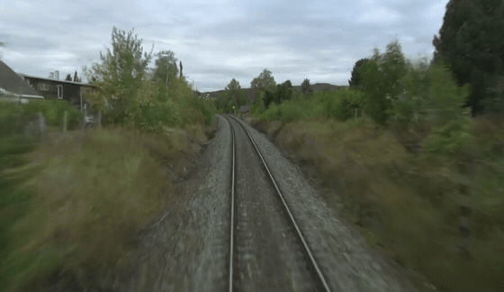
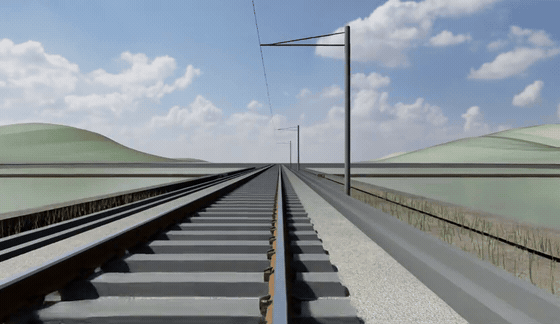
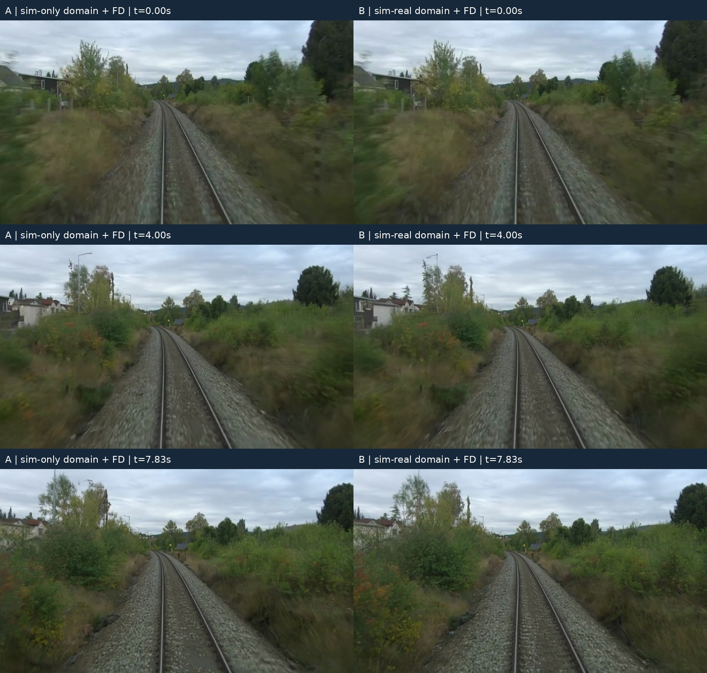
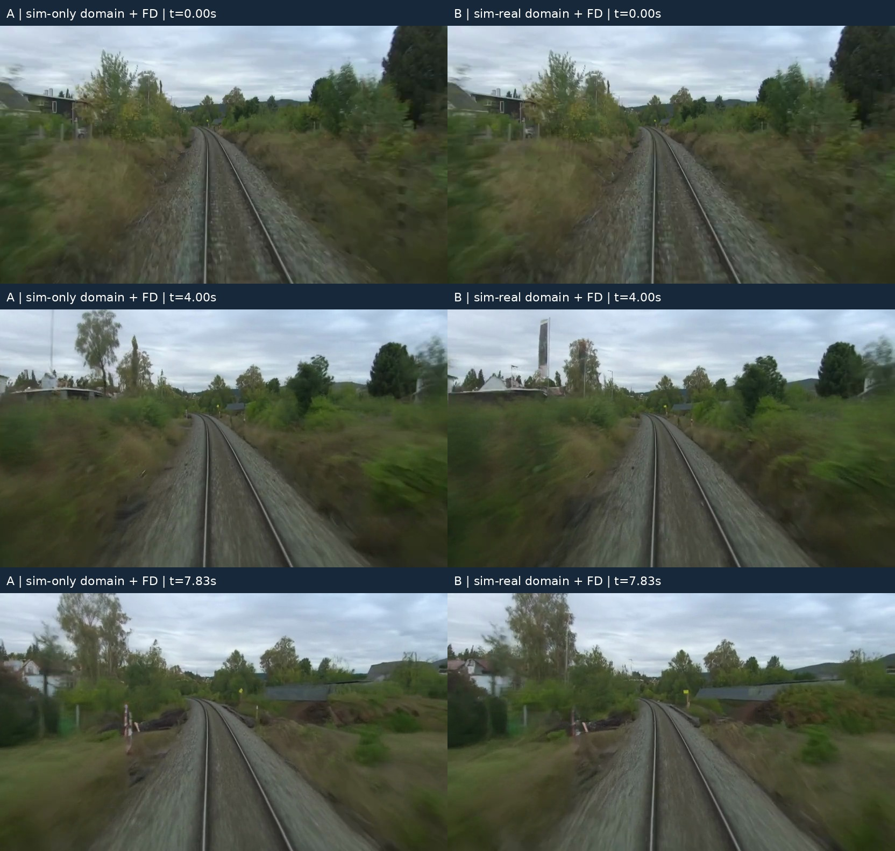
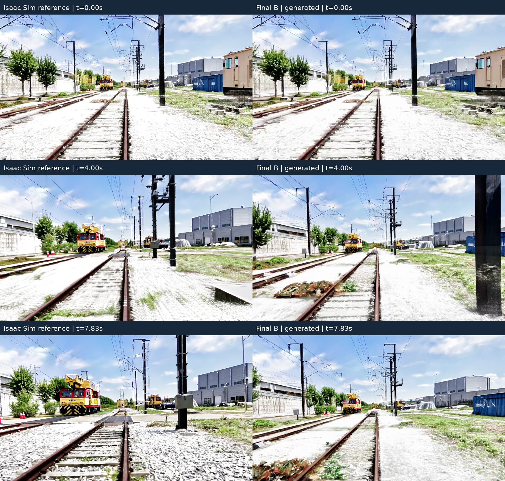
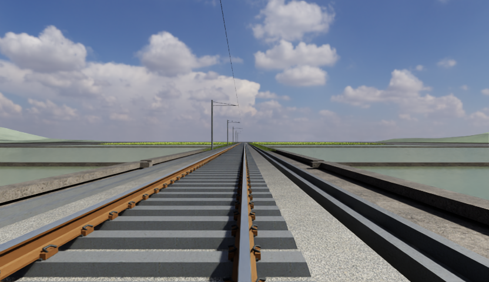

# 대표 영상과 비교 결과

## 카메라 경로 조건부 모델 · 500step — 감속 요청

| 실사 첫 이미지 | 합성 철도 장면 |
|---|---|
|  |  |

같은 188×9 감속 Action과 motion-neutral prompt, seed401, UniPC30·guidance1·shift10으로 생성한 기존 결과다. 입력 이미지만 다르다. 두 장면 모두 후반에 배경 이동이 감소하는 경향이 기록됐으며 시간순 대표 프레임을 확인했다. 실사 장면은 높은 열차 시점을 유지하고 수목·집의 디테일이 변한다. 합성 장면은 학습에 노출된 이미지이며 침목 반복 무늬가 남는다.

원본 전체189프레임·24FPS·832×480을 H.264 스트림 복사로 재포장했다. GIF는 전체 길이를8FPS·가로560픽셀로 줄인 미리보기로, 보간·슬로모션·선명화 없이 생성했다. 새 추론은 수행하지 않았다. [파일·편집 manifest](../assets/results/portfolio_manifest.json)

실사 입력의 동일성은 SHA-256으로 기록한다. 원천 실사 영상이나 시설 원본 자료는 제공하지 않는다. 자료의 이용 조건은 [THIRD_PARTY](../THIRD_PARTY.md)에 정리했다.

## 이전300step 모델 — 동일 조건 A/B 비교

기존 생성 결과를 같은 길이·재생 속도로 편집했다. A/B의 차이와 제어 실패를 함께 비교한다.

이하 A/B의 B 영상은 FD300 결과다. 위 FD500 영상과 구분한다.

**A:** 가상 RGB 전용 domain 적응 → 가상 RGB·camera Action FD 적응.

**B:** 가상·실사 혼합 domain 적응 → 같은 가상 RGB·camera Action FD 적응.

두 모델은 기존 철도 초기값을 계승했다. 동일 조건 기록을 확인한 STOP·accel10·decel30만 A/B 짝으로 사용했다. 입력 이미지·장면 설명·seed401·189프레임·24 FPS·UniPC30·guidance1·shift10을 맞춘 기존 실행이다. const10은 대응 A 결과가 없어 A/B 비교로 만들지 않았다.

## 1. 감속 요청: 보이는 경향과 측정되지 않은 것

[감속 A/B 비교영상 재생](../assets/results/ab_decel30.mp4)

30→0 km/h로 계획한 camera Action을 입력했다. 동일 시간 간격의 프레임에서는 후반 장면 변화가 줄어드는 경향이 관찰됐다. 실제 속도나 완전 정지를 측정한 결과는 아니며, B의 일관된 개선도 확인하지 못했다.

## 2. 가속 요청: 전진 생성과 가속 정확도는 별개

[가속 A/B 비교영상 재생](../assets/results/ab_accel10.mp4)

0→10 km/h에 해당하는 계획 Action을 입력했다. A/B 모두 전방 장면 변화가 보이지만 나무·건물·기둥의 세부 형상이 달라지거나 늘어난다. 전진하는 것만으로 가속도나 실제 km/h 정확도를 확인할 수 없다.

## 3. STOP 실패: 정지 요청에도 영상이 전진함

[STOP 실패 비교영상 재생](../assets/results/ab_stop.mp4)

이동0·항등 회전의 Action을 입력했으나 두 결과 모두 주변 건물·수목이 가까워진다. STOP 명령을 따르지 못한 사례다.

## 4. 시뮬레이터 원본과 Rail World Model의 차이

[Isaac Sim 원본 / B 생성 비교영상 재생](../assets/results/sim_gt_vs_b_decel30.mp4)

같은 초기 관측·감속 궤적에 대응하는 시뮬레이터 영상과 생성 결과를 나란히 둔다. 레일·시설물의 배치가 얼마나 유지되는지 보는 자료다. 픽셀 단위 복원 성공이나 새로운 철도 현장 일반화 증거가 아니다. 원래 스캔/렌더링 자체의 결함도 포함된다.

## 5. 실제 학습 데이터에 포함된 합성 환경

| 논길 환경 | 터널 환경 |
|---|---|
|  |  |

두 이미지는 Isaac Sim용 합성 환경에서 렌더링한 학습 영상의 60번 프레임이다. 모델 생성 결과가 아닌 학습 입력 자료다.

## 출처·편집·검증

- A/B는 기존 실사 첫 이미지 조건 생성물이다. 첫 관측의 원천은 NRK Nordlandsbanen 가을 synchronized 영상의 기존 curated validation frame이다. 원천 실사 영상 전체나 별도 실사 학습 클립은 포함하지 않는다. 생성 결과를 실제 촬영 미래 영상으로 표시하지 않는다.
- 맵·학습 이미지와 시뮬레이터 기준 영상은 프로젝트의 기존 자산이다. 원본 자산·가중치는 제공하지 않으며 자료별 이용 범위는 [THIRD_PARTY](../THIRD_PARTY.md)에 정리했다.
- 영상은 전체189프레임·24 FPS·순서를 유지했다. 원본832×480 두 영상을 크롭 없이 가로 배치하고 바깥48픽셀 여백에만 라벨을 추가했다.
- MP4는 H.264/yuv420p/faststart로 재인코딩했다. 프레임 보간·슬로모션·AI 보정·선명화 없음. 원본은 보존했다.
- JPG 대표 프레임은 0/96/188이다. 미리보기만 JPEG이며, 원본 영상의 시각을 바꾸지 않았다.
- 네 비교영상 모두 전체 디코딩과1664×528·189프레임·24 FPS를 확인했다. 해시·선택 이유는 [미디어 manifest](../assets/results/manifest.json), 내부 원본 경로와 편집 명령은 Git 제외 기록에 보존했다.
- 정성 판정은 기존 보고서와 대표 프레임 검토에 근거한다. 영상 유사도·광학 흐름만으로 속도 정확도나 일반화 성공을 주장하지 않는다.
