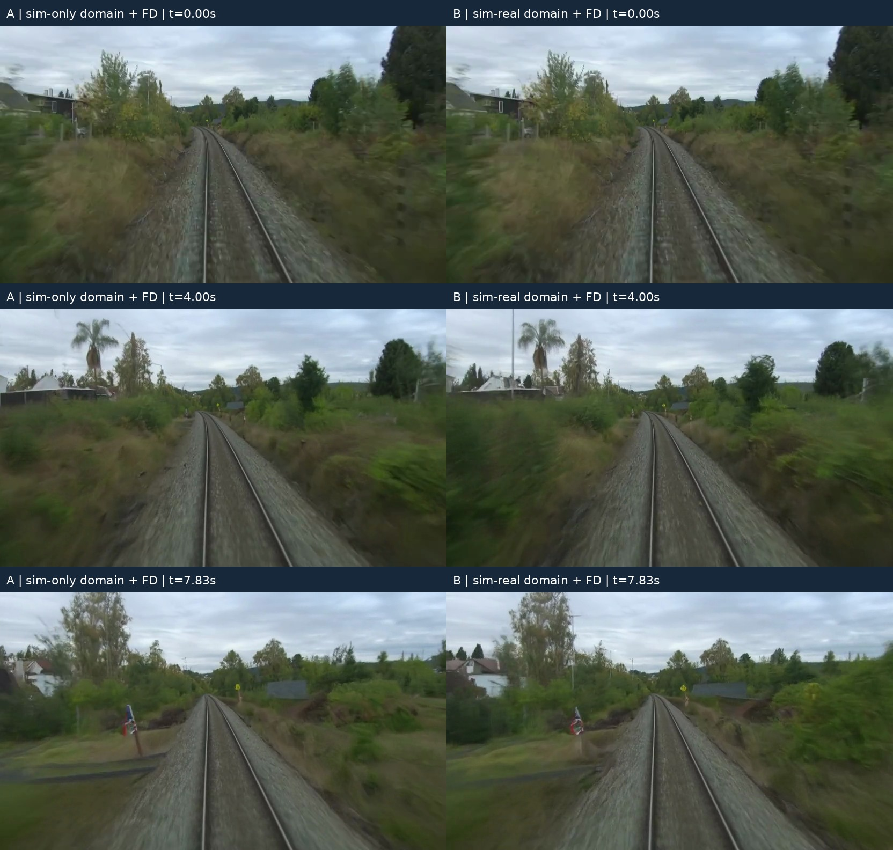
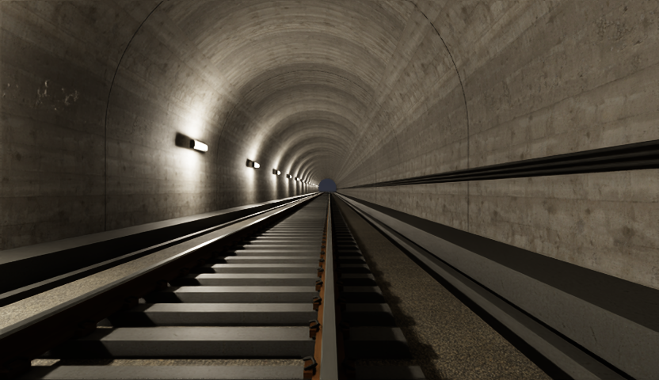

# 대표 결과: 같은 조건에서 달라진 것과 남은 한계

## 대표 결과 — 동일 조건 비교

기존 생성물을 편집한 자료이며 새 학습·추론은 하지 않았다. 사용자가 대표 결과의 GitHub 게시를 요청한 범위에서 영상·이미지만 추가한다. 맵 원본·실사 원천 클립·모델 가중치는 배포하지 않는다.

**A:** 가상 RGB 전용 domain 적응 → 가상 RGB·camera Action FD 적응.

**B:** 가상·실사 혼합 domain 적응 → 같은 가상 RGB·camera Action FD 적응.

두 모델은 기존 철도 초기값을 계승했다. 동일 조건 기록을 확인한 STOP·accel10·decel30만 A/B 짝으로 사용했다. 입력 이미지·장면 설명·seed401·189프레임·24 FPS·UniPC30·guidance1·shift10을 맞춘 기존 실행이다. const10은 대응 A 결과가 없어 A/B 비교로 만들지 않았다.

## 1. 감속 요청: 보이는 경향과 측정되지 않은 것

[감속 A/B 비교영상 재생](../assets/results/ab_decel30.mp4)

원래 요청은 30→0 km/h 감속에 해당하는 camera Action이다. 기존 동일 시간 간격 검토에서는 후반 장면 변화가 초반보다 줄어드는 경향이 관찰됐다. **정확한 속도·완전 정지·B의 성능 향상을 입증한 것은 아니다.** 이 사례 하나를 전체 제어 성공으로 확대하지 않는다.

## 2. 가속 요청: 전진 생성과 가속 정확도는 별개

[가속 A/B 비교영상 재생](../assets/results/ab_accel10.mp4)

0→10 km/h에 해당하는 계획 Action을 입력했다. A/B 모두 전방 장면 변화가 보이지만 나무·건물·기둥의 세부 형상이 달라지거나 늘어난다. 전진하는 것만으로 가속도나 실제 km/h 정확도를 확인할 수 없다.

## 3. STOP 실패: 정지 요청에도 영상이 전진함

[STOP 실패 비교영상 재생](../assets/results/ab_stop.mp4)

이동0·항등 회전의 Action을 입력했으나 두 결과 모두 주변 건물·수목이 가까워지는 시점 변화가 관찰된다. **STOP 제어 실패 사례다.** 결과를 좋게 보이도록 숨기거나 정지 성공으로 이름 붙이지 않았다.

## 4. 시뮬레이터 원본과 최종 B의 차이

[Isaac Sim 원본 / B 생성 비교영상 재생](../assets/results/sim_gt_vs_b_decel30.mp4)

같은 초기 관측·감속 궤적에 대응하는 시뮬레이터 영상과 생성 결과를 나란히 둔다. 레일·시설물의 배치가 얼마나 유지되는지 보는 자료다. 픽셀 단위 복원 성공이나 새로운 철도 현장 일반화 증거가 아니다. 원래 스캔/렌더링 자체의 결함도 포함된다.

## 5. 실제 학습 데이터에 포함된 합성 환경

| 논길 환경 | 터널 환경 |
|---|---|
|  |  |

두 이미지는 학습 원천 영상의 60번 프레임이다. 실제 현장 사진이나 모델 생성 결과가 아니라 **Isaac Sim용 합성 환경의 렌더링**이다. 가상 자료만으로 주변 현실성을 학습하는 데 한계가 있다는 연구 맥락과 연결된다.

## 출처·편집·검증

- A/B는 기존 실사 첫 이미지 조건 생성물이다. 첫 관측의 원천은 NRK Nordlandsbanen 가을 synchronized 영상의 기존 curated validation frame이다. 원천 실사 영상 전체나 별도 실사 학습 클립은 포함하지 않는다. 생성 결과를 실제 촬영 미래 영상으로 표시하지 않는다.
- 맵/학습 이미지와 시뮬레이터 기준 영상은 프로젝트의 기존 자산이며, 이번 게시 요청 범위의 대표 자료다. 그 원본 자산·가중치의 일반 재배포 허가를 뜻하지 않는다.
- 영상은 전체189프레임·24 FPS·순서를 유지했다. 원본832×480 두 영상을 크롭 없이 가로 배치하고 바깥48픽셀 여백에만 라벨을 추가했다.
- MP4는 H.264/yuv420p/faststart로 재인코딩했다. 프레임 보간·슬로모션·AI 보정·선명화 없음. 원본은 보존했다.
- JPG 대표 프레임은 0/96/188이다. 미리보기만 JPEG이며, 원본 영상의 시각을 바꾸지 않았다.
- 네 비교영상 모두 전체 디코딩과1664×528·189프레임·24 FPS를 확인했다. 해시·선택 이유는 [미디어 manifest](../assets/results/manifest.json), 내부 원본 경로와 편집 명령은 Git 제외 기록에 보존했다.
- 정성 판정은 기존 보고서와 대표 프레임 검토에 근거한다. 영상 유사도·광학 흐름만으로 속도 정확도나 일반화 성공을 주장하지 않는다.
